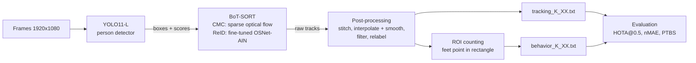
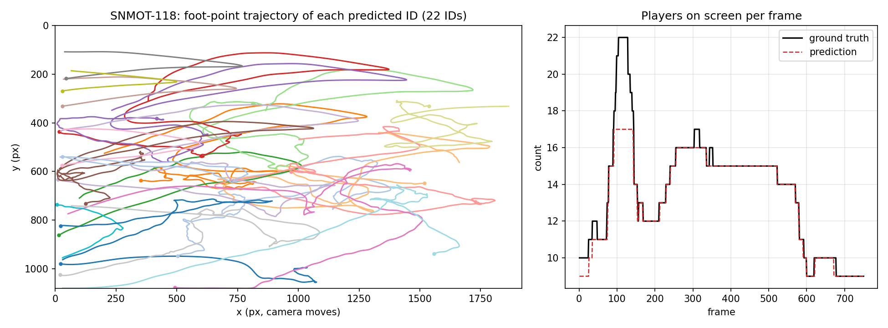
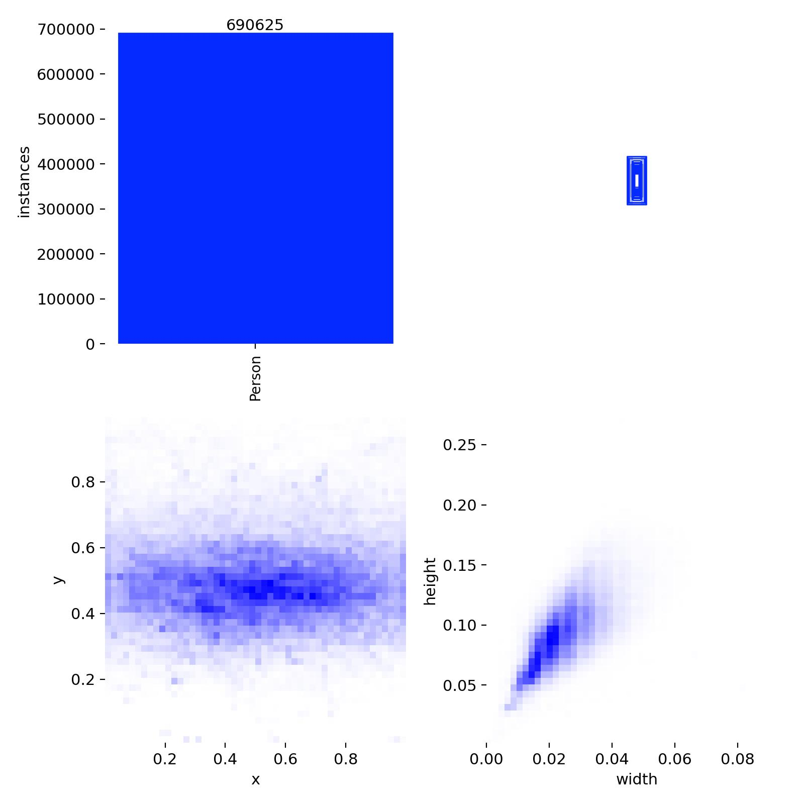
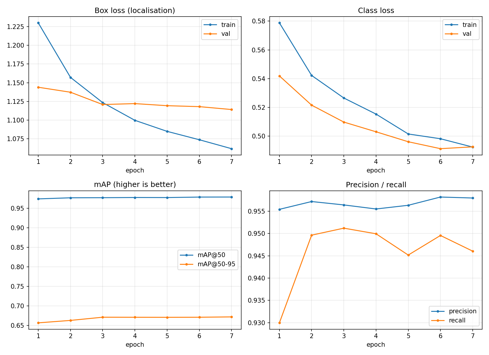
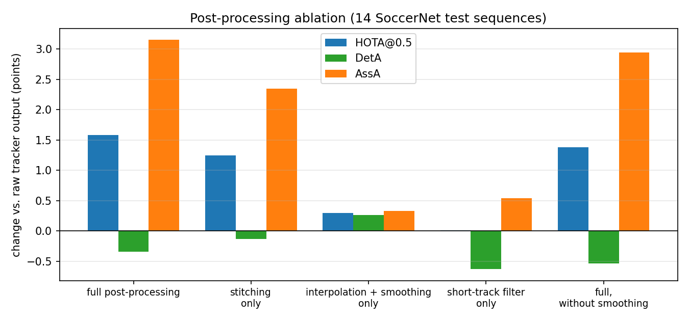

# Soccer Tracker — player detection, tracking & behaviour analysis for broadcast soccer

End-to-end computer-vision pipeline that detects every player and referee in 1080p broadcast soccer footage, keeps a
consistent identity for each of them despite a moving camera, occlusions and identical kits, and counts how many players
stand inside given regions of the pitch.

Built for the **Artificial Vision 2025-26 "Soccer Video Understanding Challenge"** (MSc Computer Engineering, University of
Salerno, Group 27).

| Stage | Method | Result |
|---|---|---|
| Detection | YOLO11-L fine-tuned on SoccerNet (1920 px, frozen backbone) | P 0.958 · R 0.946 · mAP@50 0.979 · mAP@50-95 0.672 |
| Re-identification | OSNet-AIN x1.0 fine-tuned (triplet + label-smoothed CE) | Rank-1 97.5 % · mAP 86.0 % (optimistic, see [limitations](#evaluation-protocol-and-limitations)) |
| Tracking | BoT-SORT (sparse-optical-flow camera-motion compensation + ReID) + offline tracklet stitching | HOTA@0.5 **82.3 %** (DetA 90.0, AssA 75.3) on 14 of the 49 SoccerNet test sequences, a development set; the report quotes 67.5 % on all 49 |
| Behaviour | Base-centre-of-box-in-ROI player counting | nMAE metric, evaluated on the hidden contest set |

Contest score: `PTBS = HOTA@0.5 + nMAE`.

## Pipeline



Output formats follow the contest specification: `frame_id,object_id,x,y,w,h` (tracking) and
`frame_id,region_id,n_players` (behaviour), with frames and ids starting at 1.

Example output on one SoccerNet test sequence (750 frames): the trajectories of the 22 identities the tracker assigned
(left) and the number of players it sees per frame compared to the ground truth (right). The camera pans, so trajectories
are in screen coordinates. The count drops below the ground truth during the crowded phase around frame 100.



## Repository layout

```
soccer_tracker/            Python package
  data.py                  SoccerNet download, conversion to YOLO format, sub-sampling, visual checks
  detection.py             YOLO fine-tuning / validation, training-curve plots
  reid.py                  ReID crop dataset builder + OSNet-AIN fine-tuning (Torchreid) + weight export
  tracking.py              detector -> BoT-SORT inference (one fresh tracker per video)
  postprocess.py           tracklet stitching, interpolation + smoothing, short-track filter, id relabelling
  behavior.py              ROI player counting and behaviour file writer
  evaluation.py            HOTA@0.5 / DetA / AssA (TrackEval), nMAE, PTBS
  viewer.py                MP4 rendering and interactive GT-vs-prediction viewer
  cli.py                   `python -m soccer_tracker <command>`
configs/                   pipeline.yaml · botsort_soccer.yaml · yolo_train.yaml (all hyper-parameters)
weights/                   fine-tuned YOLO11-L detector and OSNet-AIN ReID model (see weights/README.md)
results/detector_training/ results.csv, args.yaml, label statistics and training curves of the released detector run
scripts/                   make_readme_figures.py (regenerates results/figures from real outputs)
tests/                     pytest suite (55 tests, no GPU or dataset needed)
```

## Installation

Python ≥ 3.10 and, for reasonable speed, a CUDA GPU (tested on an RTX 3060 Laptop, 6 GB).

```bash
# 1. PyTorch matching your CUDA version (https://pytorch.org/get-started/locally/)
pip install torch==2.2.2 torchvision==0.17.2 --index-url https://download.pytorch.org/whl/cu121

# 2. everything else (versions tested with this code are pinned)
pip install -r requirements.txt
```

`torchreid` is only needed to *re-train* the ReID model, not for inference:
`pip install git+https://github.com/KaiyangZhou/deep-person-reid.git`.

## Usage

Inference expects one folder per video:

```
test_set/videos/<id>/img1/000001.jpg ...     frames
test_set/videos/<id>/roi.json                two ROIs in normalised coordinates (needed for behaviour analysis)
test_set/videos/<id>/gt/gt.txt               ground truth, only needed for evaluation
test_set/videos/<id>/gt/behavior_gt.txt      behaviour ground truth, optional
```

```bash
# detect -> track -> post-process -> behaviour analysis (+ metrics if ground truth is available)
python -m soccer_tracker run --sequences test_set/videos --out Predictions_folder --evaluate

# metrics only
python -m soccer_tracker evaluate --sequences test_set/videos --predictions Predictions_folder --team-id 27

# render a tracked video with IDs and live ROI counts
python -m soccer_tracker render --frames test_set/videos/1/img1 --tracking Predictions_folder/tracking_1_27.txt \
    --roi test_set/videos/1/roi.json --out demo.mp4
```

`--out` also receives `raw/` (tracker output before post-processing) so the effect of each post-processing step can be
ablated: run `evaluate --predictions Predictions_folder/raw` against `--predictions Predictions_folder`.

### Evaluating on the SoccerNet test split

The 49 labelled SoccerNet *test* sequences (≈ 7-10 GB) can be used to measure HOTA@0.5 / DetA / AssA. They have no `roi.json`,
so behaviour analysis is skipped. Inference runs at about 6 frames/s on a laptop GPU (≈ 100 min for all 49 sequences); `--only` evaluates a subset:

```bash
python -m soccer_tracker prepare-data --download --splits test      # 8.7 GB from the Hugging Face mirror -> SoccerNetData/tracking/test/SNMOT-*
python -m soccer_tracker run --sequences SoccerNetData/tracking/test --out Predictions_test \
    --only SNMOT-116 SNMOT-117 SNMOT-118 --evaluate                  # ball tracklets are removed from the GT automatically
```

### Reproducing the training

```bash
python -m soccer_tracker prepare-data --download                 # SoccerNet tracking -> YOLO dataset (several GB)
python -m soccer_tracker check-data --save-dir viz                # draw converted boxes to verify the conversion
python -m soccer_tracker train-detector --data YoloDataset/data.yaml   # configs/yolo_train.yaml = released run

python -m soccer_tracker build-reid-data                          # identity crops from the GT
python -m soccer_tracker train-reid                               # needs torchreid + osnet_ain_x1_0_imagenet.pth
python -m soccer_tracker export-reid log/osnet_soccer/model/model.pth.tar-40
```

All commands have `--help`. Hyper-parameters live in `configs/`, not in the code.

### Tests

```bash
pip install pytest && pytest -q
```

The suite builds tiny synthetic datasets, so it needs neither GPU nor SoccerNet. Tests that need optional dependencies
(TrackEval, BoxMOT + the released ReID weights) skip themselves when those are missing.

## How it works

**Detection.** All SoccerNet player/goalkeeper/referee tracklets are mapped to a single `Person` class (the ball is
dropped) so the model learns to ignore coaches, photographers, substitutes and crowd. YOLO11-L was fine-tuned at 1920 px
with the first 10 layers frozen (AdamW, lr 1e-4, `box=7.5`, `cls=0.5`), because small, distant players need full
resolution. Inference uses a deliberately low confidence (0.20) and a high NMS IoU (0.65) to keep blurred far-away
players and players overlapping in a tackle.

The training set has 690 625 person boxes, which are small: a typical box is about 2 % of the image width and 9 % of its
height (≈ 40 × 100 px at 1080p), concentrated around the pitch centre. This is why detection runs at full 1920 px resolution.



Comparison of the candidate runs (from the report):

| Run | Model | Image size | Recall | mAP@50 | mAP@50-95 |
|---|---|---|---|---|---|
| v01 | YOLO11-M | 736 | 0.942 | 0.974 | 0.652 |
| v07 | YOLO11-X | 1824 | 0.943 | 0.971 | 0.645 |
| **v06** | **YOLO11-L** | **1920** | **0.951** | **0.977** | **0.671** |



**Re-identification.** Teammates wear identical kits, so generic ReID features fail. OSNet-AIN (omni-scale features +
instance normalisation, robust to lighting changes) is fine-tuned on crops taken from the SoccerNet ground truth
(every 10th frame, boxes ≥ 1000 px², upright boxes only) with a `RandomIdentitySampler` and triplet + label-smoothed
cross-entropy loss. The released weights are the epoch-40 checkpoint.

**Tracking.** BoT-SORT fuses motion (Kalman filter on box centre/size, camera-motion compensation by sparse optical flow)
and appearance (cosine distance of ReID embeddings). The configuration is tuned for recall — see the commented
[`configs/botsort_soccer.yaml`](configs/botsort_soccer.yaml): low confidence thresholds, a long track buffer so players
leaving and re-entering the frame keep their id, and permissive association gates because teammates look alike.

**Post-processing** ([`postprocess.py`](soccer_tracker/postprocess.py)), applied per video:
1. *Stitching* — a track that ends is linked to a track that starts within 50 frames and 150 px of its constant-velocity
   extrapolation. Candidate pairs are solved as a global one-to-one assignment (Hungarian algorithm), and chains of any
   length are merged.
2. *Interpolation + smoothing* — gaps up to 10 frames are linearly interpolated; longer gaps are left empty; boxes are
   Gaussian-smoothed (σ = 2) within each contiguous segment only.
3. *Filtering* — tracks shorter than 50 frames (2 s) are removed.
4. *Relabelling* — ids are renumbered 1..N.

### Post-processing ablation

Re-scoring the same raw tracker output (`run` keeps it in `<out>/raw`) with different post-processing settings, on 14 SoccerNet
test sequences (10 500 frames, evenly spread over the split; `python -m soccer_tracker ablate`):

| Variant | HOTA@0.5 | DetA | AssA |
|---|---|---|---|
| raw tracker output | 0.8073 | 0.9035 | 0.7213 |
| **full post-processing** | **0.8231** | 0.9001 | 0.7528 |
| stitching only | 0.8198 | 0.9022 | 0.7448 |
| interpolation + smoothing only | 0.8103 | 0.9061 | 0.7246 |
| short-track filter only | 0.8074 | 0.8972 | 0.7267 |
| full, without smoothing | 0.8211 | 0.8982 | 0.7507 |



Post-processing adds about 1.6 HOTA points, almost all through association (AssA): stitching is the step that matters,
interpolation helps detection slightly, and the short-track filter only pays off in combination with the others.

**Behaviour analysis.** A player is inside an ROI when the base-centre of its box, `(x + w/2, y + h)`, lies in the
rectangle (borders included). Every frame and region is written, with 0 when nobody is inside.

## Evaluation protocol and limitations

Please read the numbers above with these caveats in mind:

* **The 82.3 % is not comparable to the report's 67.5 %.** They come from different samples (14 vs 49 sequences) and the report does not
  say how the ground truth was prepared. Here the ball tracklet is removed from the GT, as the detector never predicts it
  (keeping it lowers HOTA to 79.8 % on the same 14 sequences, through DetA). Evaluating all 49 sequences with this code
  takes about 100 minutes.
* **No held-out test labels.** The SoccerNet *test* split (49 sequences, 36 750 frames) was used as validation set during
  detector training (checkpoint selection) *and* to tune the tracker/post-processing parameters, so the reported mAP and
  HOTA are development-set numbers and probably optimistic. The contest test set (5 hidden videos) is not available.
* **ReID metrics are optimistic.** The SoccerNet ground truth contains identities only within one clip; query and gallery
  images of an identity come from the same tracklet (a different `camid` is used only to enable the standard protocol).
  Rank-1/mAP therefore measure within-tracklet discrimination more than genuine re-identification.
* **Single detector class.** Referees are detected and tracked like players (they are also part of the ReID identities), so
  they are counted in the ROIs; this matches the "count everyone on the pitch" interpretation, not a "players only" one.
* **Speed.** About 6 frames/s (750 frames in ≈ 2 min) at 1920 px in fp32 on a 6 GB laptop GPU (YOLO11-L + OSNet-AIN): well below the 25 fps of the footage, so this is an offline pipeline.
* **Detector training length.** `results/detector_training/results.csv` logs 7 of the 50 planned epochs; the metrics had
  largely saturated (see the curves). `best.pt` is the epoch-7 checkpoint (highest fitness).
* The PDF report quotes slightly different post-processing values (stitch 20 frames / 80 px, interpolation gap 20) than
  the final script; [`configs/pipeline.yaml`](configs/pipeline.yaml) holds the values of the final script.
* With BoxMOT 16.0.1, `det_thresh` and `iou_threshold` of the tracker YAML are accepted but unused, and the effective track
  buffer is `int(frame_rate / 30 * track_buffer)` = 125 frames.

## Acknowledgements

[SoccerNet](https://www.soccer-net.org/) tracking data · [Ultralytics YOLO11](https://github.com/ultralytics/ultralytics) ·
[BoxMOT](https://github.com/mikel-brostrom/boxmot) · [Torchreid](https://github.com/KaiyangZhou/deep-person-reid) ·
[TrackEval](https://github.com/JonathonLuiten/TrackEval) · BoT-SORT (Aharon et al., 2022) · OSNet (Zhou et al., 2019).

Authors: Salvatore Francesco Tartaglione, Candido Simone Savino — University of Salerno, Artificial Vision, A.Y. 2025-26.
